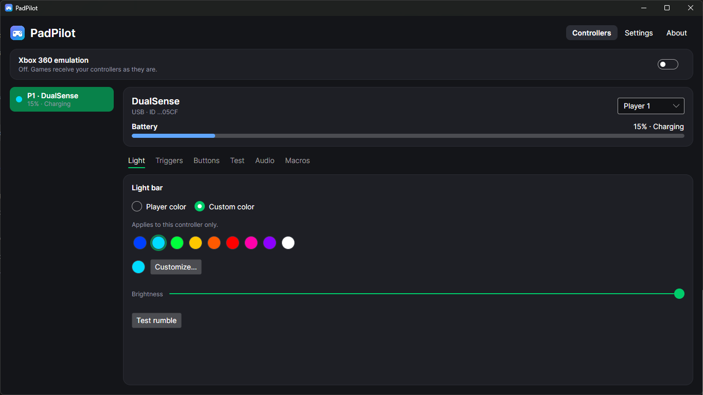

# PadPilot

Gestor de mandos para Windows: **DualSense**, **DualSense Edge**, **DualShock 4** y mandos **genéricos**,
por USB o Bluetooth. Vive en la bandeja del sistema y cada mando recuerda su configuración.

Autor: **ExO** · Versión **1.0.0** · Español / English · [Web](https://exobrienx.github.io/PadPilot/) · [Descargas](https://github.com/ExOBrienX/PadPilot/releases/latest)



## Funciones

- **Mandos:** varios a la vez, con jugador 1-4. Los genéricos se configuran solos (descriptor HID) o con el asistente "uno por uno".
- **Luz:** color por jugador o por mando, intensidad. Indicadores de batería baja y de carga con prioridad sobre los juegos.
- **Gatillos adaptativos:** perfiles de un clic (pistola, escopeta, ametralladora, arco, coche) y ajuste fino.
- **Botones:** remapeo a botones Xbox, teclas, atajos de Windows o macros.
- **Macros:** secuencias de teclas y botones Xbox con tiempos; una vez o en repetición mientras se mantiene.
- **Probar:** sticks, gatillos, botones y touchpad en vivo; calibración de centro y zona muerta contra el drift.
- **Audio (USB):** micrófono con medidor, volumen y botón Mute con LED; escucharse y grabar; audífonos del mando.
- **Emulación Xbox 360** (ViGEmBus) en el orden de los jugadores, con vibración.
- **HidHide** (opcional): oculta los mandos originales a los juegos mientras se emula.
- **Ajustes:** idioma, tema claro/oscuro, diseño vertical u horizontal, inicio con Windows.

## Requisitos

| Componente | Para qué |
|---|---|
| Windows 10/11 64 bits | — (.NET viene incluido en el .exe) |
| [ViGEmBus](https://github.com/nefarius/ViGEmBus/releases/latest) | Solo emulación Xbox 360 |
| [HidHide](https://github.com/nefarius/HidHide/releases/latest) | Opcional: ocultar el mando original durante la emulación |

## Desarrollo

Requiere el [.NET 10 SDK](https://dotnet.microsoft.com/download).

```bash
dotnet build                                   # compila todo
dotnet run --project src/PadPilot.App          # la app
dotnet run --project tools/PadPilot.Probe      # consola de diagnóstico del protocolo
```

### Publicar

```bash
dotnet publish src/PadPilot.App -c Release -r win-x64 --self-contained -p:PublishReadyToRun=true -p:DebugType=none -o publish/folder
```

Genera una carpeta portable con `PadPilot.exe` (incluye .NET). Se usa carpeta y no archivo único porque
**Smart App Control** de Windows 11 bloquea los `.exe` grandes sin firmar; la carpeta pasa mejor mientras
la app no esté firmada. Al subir una etiqueta `vX.Y.Z`, GitHub Actions compila y publica el release solo. Antes de publicar, completa los enlaces en
`src/PadPilot.App/Services/AppInfo.cs` (Ko-fi, repositorio, web) y en `docs/index.html` (`CONFIG`).

### Sitio web

`docs/` es la página del proyecto para **GitHub Pages** (Settings → Pages → rama `main`, carpeta `/docs`).

## Estructura

```
src/PadPilot.Core/     Núcleo sin interfaz: protocolo HID, mandos, perfiles, luces
src/PadPilot.App/      Interfaz Avalonia, emulación (ViGEm), HidHide, audio, macros, textos ES/EN
tools/PadPilot.Probe/  Consola de diagnóstico
docs/                  Sitio web (GitHub Pages)
```

## Notas técnicas

- **Bluetooth:** DualSense y DS4 empiezan con un reporte reducido; leer el feature report 0x05 activa el completo.
- **CRC32:** por Bluetooth cada reporte de salida termina en un CRC32 (semilla `0xA2`); si falla, el mando lo ignora.
- **Batería:** se informa en pasos de 10 % (5, 15, 25…).
- **Luces con prioridad:** se reenvían cada segundo solo las luces (sin tocar vibración ni gatillos).
- **USB + Bluetooth a la vez:** se prefiere la conexión USB (tiene audio).

## Licencia

PadPilot es software libre bajo la licencia **GPL-3.0** (ver `LICENSE`). Puedes usarlo, estudiarlo y modificarlo;
si lo redistribuyes, debe ser con su código fuente y bajo la misma licencia.

Si te resulta útil, puedes apoyar su desarrollo con una donación (enlace en la app, en *Acerca de*).

## Marcas

PlayStation, DualSense y DualShock son marcas de Sony Interactive Entertainment. Xbox es una marca de Microsoft.
PadPilot no está afiliado a ninguna de ellas. Componentes de terceros: ver `THIRD-PARTY-NOTICES.txt`.
